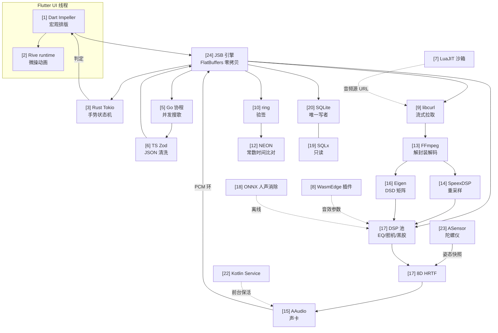

# 数据流向图 · Yieyu-Ultimate-Player

> 所有图都遵循 `docs/ARCH_24.md` 的七条铁律。**方括号里是模块号**。
> 三条主线：**控制面**（JSB / FlatBuffers，跨语言）、**数据面**（共享内存环，零拷贝）、
> **磁盘面**（SQLite，唯一写者）。

---

## 0. 总体一图流

```
┌─────────────────────────────────────────────── ANDROID 进程（单进程，多线程） ───────────────────────────────────────────────┐
│                                                                                                                              │
│  ┌─ Flutter UI 线程（Impeller / Vulkan） ─────────────────┐        ┌─ 系统层（全场唯一 Kotlin，≤400 行）[22] ─┐            │
│  │ [1] Dart 宏观排版：路由 / 列表 / 页面                  │        │  PlaybackService (前台服务 / MediaSession)│            │
│  │ [2] Rive C++ runtime：EQ 曲线 / 呼吸灯（脏区重绘）      │        │  Notification / 输入法唤起                 │            │
│  └───────────────▲───────────────────────────┬───────────┘        └──────────────▲───────────────────────────┘            │
│                  │ JSB 事件上行(FlatBuffers)  │ JSB 下行(命令/触摸)               │ 只读状态快照（无业务逻辑）                 │
│                  │                          ▼                                    │                                            │
│  ┌───────────────┴──────────────────────────────────────────────────────────────┴──────────────────────────────────────┐    │
│  │                                        [24] JSB 引擎（C++，自研，dart:ffi 直连）                                    │    │
│  │   · 无 JNI（Dart↔C++ 走 dart:ffi）· FlatBuffers 零拷贝 · 单线程收，多线程发 · 背压窗口 256                            │    │
│  └───┬──────────────┬───────────────┬──────────────┬───────────────┬──────────────┬──────────────┬──────────────────┬──┘    │
│      │              │               │              │               │              │              │                  │        │
│   [校验]         [手势]          [网络]         [解码]         [重采样]         [DSP]        [空间化]            [存储]       │
│      ▼              ▼               ▼              ▼               ▼              ▼              ▼                  ▼        │
│  ┌────────┐   ┌──────────┐   ┌───────────┐  ┌──────────┐   ┌──────────┐   ┌──────────┐   ┌──────────┐      ┌──────────┐   │
│  │[10]ring│   │[3] Tokio │   │[9] curl   │  │[13]FFmpeg│   │[14] SpeexDSP │   │[17] 池   │   │[17]8D    │      │[20]SQLite│   │
│  │ 验签   │   │ 手势状态机│   │ 流式拉取   │  │ 解封装解码│   │ 重采样    │   │ EQ/胆机  │   │ ←[23]陀螺│      │ C++ 写者  │   │
│  │ +[12]  │   │ 防误触    │   │ Range     │  │ FLAC→PCM │   │ 44.1→192k│   │ 黑胶     │   │  ASensor │      │  WAL      │   │
│  │ NEON   │   │ 长按震动  │   │ →环形缓冲 │  │          │   │          │   │          │   │          │      │          │   │
│  └───┬────┘   └────┬─────┘   └─────┬─────┘  └────┬─────┘   └────┬─────┘   └────┬─────┘   └────┬─────┘      └────▲─────┘   │
│      │             │               │             │              │              │              │                  │          │
│      │             │               │             ▼              ▼              ▼              │                  │          │
│      │             │               │        ┌───────────────────────────────────────────┐    │                  │          │
│      │             │               │        │  PCM 环（无锁 SPSC，FlatBuffers 头）[21]   │    │                  │          │
│      │             │               │        └───────────────────┬───────────────────────┘    │                  │          │
│      │             │               │                            ▼                            │                  │          │
│      │             │               │                   ┌────────────────┐                    │                  │          │
│      │             │               │                   │[15] AAudio 回调 │◄───────────────────┘                  │          │
│      │             │               │                   │ 4ms/块 零JNI   │                                       │          │
│      │             │               │                   └────────┬───────┘                                       │          │
│      │             │               │                            ▼                                               │          │
│      │             │               │                      🔊 声卡 / 蓝牙 / USB DAC                              │          │
│      │             │               │                                                                            │          │
│      │             │               └──────────► [5] Go 协程搜歌 ──► [6] TS/Zod 洗数据 ──► JSB 上行 ──► [1][2]   │          │
│      │             │                                                                                            │          │
│      │             └──► 判定结果 ──► [3]so ──► Dart ──► [1] 响应（按钮态 / 震感）                                │          │
│      │                                                                                                          │          │
│      └──► 校验失败 ──► 熔断：停解码、清PCM环、置灰UI（不崩进程）                                                 │          │
│                                                                                                                 │          │
│  沙箱区（与主程序隔离）：                                                                                        │          │
│    [7] LuaJIT 音源脚本 ──► 只允许返回 URL/元数据（白名单 API）                                                     │          │
│    [8] WasmEdge 插件   ──► 只允许改写 32~64 采样点的 DSP 参数（无系统调用）                                        │          │
│    [18] ONNX 人声消除  ──► 由 DSP 池在"离线/非实时"通道调用，绝不进 AAudio 回调                                    │          │
└──────────────────────────────────────────────────────────────────────────────────────────────────────────────────────────────┘
                                                         ▲            ▲
                                    （只读）[19] Rust SQLx ─┘            │ 搜歌/热更新
                                                         │            │
                                                  共享 SQLite 文件   Go/curl → 网易 / QQ / 酷狗 / 插件CDN
```

---

## 1. 冷启动 + 授权链（先验签，再出声）

```
Kotlin [22] Activity.onCreate
        │ ① 前台服务起 → startForeground(通知栏)
        ▼
C++ core [24] jsb_init(filesDir, abi)
        │ ② dlopen libyieyu_license.so [10]（句柄常驻，不反复 dlopen）
        ▼
Rust [10] ring 验签  ── RSA-2048/Ed25519 公钥只在这里 ──►  ✓ / ✗
        │                                   │
        │                              ✗ ───┘ → 返回 LIC_FAIL → UI 置灰 + 停解码
        ▼ ✓
C++ [20] SQLite 打开（WAL，写者唯一）+ [19] Rust 只读句柄
        │ ③ 读 last_session（歌曲/进度/队列/DSP预设）
        ▼
C++ [24] → JSB 上行 ready{session, caps{abi, 192k?, dsd?, ai?}} → [1] 建首页 → [2] 播开场 Rive
```

**关键约束**：验签不通过时，**进程不崩、服务不退、UI 只置灰**（用户可退款提示页）。

---

## 2. 搜歌链（模块 5 + 6）

```
用户输入关键词（[1] Dart）
   │ JSB 下行  search{kw, sources[]}
   ▼
[24] JSB → 40 字节帧头 → 否，不走 JNI；Go 侧走 yieyu_music_search 的 C 入口（libyieyu_fetch.so）
   ▼
[5] Go：1 个 goroutine 组/源站，ctx 800ms 超时，先到先出
   ├─ netease provider ─┐
   ├─ qq provider       ├─► merge（同一首歌按 title+artist 归一，去重）
   └─ kugou provider    ┘
   ▼ 原始 JSON（脏数据）
[6] TS：Zod schema 校验 → 丢弃非法项 → 规整字段 → 干净 Song[]
   │   （执行环境二选一：WasmEdge-JS guest[8] ｜ 兜底 Go 侧同 schema 实现）
   ▼
JSB 上行 searchResult{songs[]} → [1] 列表渲染
```

---

## 3. 播放链（模块 9→13→14/16→17→15，全链路零拷贝）

```
                    ┌────────── 线程 A：IO/解码线程（非实时，可阻塞）──────────┐
[9] libcurl ────────►│ 环形 buffer(HTTP chunk) ─► [13] FFmpeg av_read_frame   │
  Range 续传/断点   │                              avcodec_decode_audio4      │
  多路并发 = 2      │  FLAC/MP3/ALAC ──────────────────────────► PCM(int16/f32)│
                    └──────────────────────────────┬───────────────────────────┘
                                                   │ 写入 PCM 环（SPSC，无锁原子序）
                                                   ▼
                    ┌────────── 线程 B：DSP 线程池（近实时，2~4 线程）─────────┐
                    │  ① [16] Eigen：DSD→PCM（DSD64/128/256 矩阵抽取 + LPF）    │
                    │  ② [14] SpeexDSP：44.1/48k ──► 192k（Q8 多相；只在"高解析"档开，默认旁路） │
                    │  ③ [17] 31 段 EQ（biquad，参数由 Rive 曲线双击联动）       │
                    │  ④ [17] 胆机软削波 + 黑胶（含 16k 陡降 LPF，蓝牙防毛刺）   │
                    │  ⑤ [17]+[23] 8D：HRTF × 陀螺仪姿态矩阵                     │
                    │  ⑥ [8] Wasm 插件：参数级改写（可选）                      │
                    └──────────────────────────────┬───────────────────────────┘
                                                   ▼ 写入 输出环
                    ┌────────── 线程 C：AAudio 实时回调（忌阻塞，忌锁，忌分配）  ─┐
                    │ [15] aaudio 48k/192k f32 → 声卡                           │
                    │   预算：192 帧 @48k = 4.0 ms；实测处理需 < 1.2 ms（30%）  │
                    └───────────────────────────────────────────────────────────┘
```

**延迟预算**（48k，192 帧/块）：`curl 抖动 ≤ 300ms（预取 3s）` → `解码 ≤ 20ms`
→ `DSP ≤ 1.2ms` → `AAudio 缓冲 2 块 = 8ms`。**端到端目标 < 20ms**（本地文件）。

---

## 4. 8D 空间化闭环（模块 23 → 17）

```
[23] ASensor（C API，绕过 Java）
     ASensorManager_getInstanceForPackage → ASensorEventQueue
     ASENSOR_TYPE_ROTATION_VECTOR @ 200Hz 或 GAME_ROTATION_VECTOR
        │  回调线程（非音频线程）
        ▼  四元数 → yaw/pitch（0.6Hz 自动旋转时用 BPM 驱动）
     ┌──────────────────────────────────────┐
     │ 姿态快照（双缓冲，seqlock 或 atomic）  │ ← 音频线程只"读"，绝不回调进入
     └───────────────┬──────────────────────┘
                     ▼ 每块取一次（4ms → 0.63° @0.6Hz，无需块内插值）
       [17] hrtf_8d：旋转矩阵 → HRTF 卷积（4 抽头 ER + 16 抽头尾）
                     ▼
                 左/右声道输出
```

**头追红线**：`hrtf_8d` 只接受"旋转矩阵"，**不许改 HRTF 库的 HRIR 数据**；
自动 8D 与头追共用同一入口，靠 `source` 字段区分（`HEADTRACK / AUTO_SPIN`）。

---

## 5. 手势链（模块 3，把触摸当高并发处理）

```
Flutter gesture detector [1] ──(原始 pointer 事件)──► JSB 下行 touch{id, x, y, t, phase}
                                                          ▼
                                            [3] Rust Tokio：每 pointer 一个 task
                                              · 防误触：滑动轨迹 + 停顿判据
                                              · 长按：50ms 定时器 + 位移阈值
                                              · 双击/三击窗口：300ms 环形缓存
                                              · 结果合并为一次事件（不刷屏）
                                                          ▼
                                            [3] so 导出 gesture_poll()（Dart FFI 轮询）
                                                          ▼
                                            Dart 16ms 拉一次 → [1] 响应 / 触发 [17] 预设切换
```

> 为什么用 Tokio：手势判定本质是"多个带超时的并发状态机"，用 async timer 写比手搓 tick 干净；
> **但 Tokio 运行在独立 OS 线程，绝不进 UI 线程**。

---

## 6. 沙箱边界（模块 7 / 8 / 18）

```
        ┌──────────────────── 允许 ─────────────────────┐        ┌────── 一律拒绝 ──────┐
[7] Lua │ http.get(url) / json / base64 / log / 返回表  │        │ os.execute io.open    │
  LuaJIT│ 指令计数 hook（默认 50M 条/调用）             │        │ 起线程 dlopen socket  │
        │ 超时 → 软掐；--hard-kill → 独立进程 SIGKILL    │        │ 读 /data 其他 app     │
        └───────────────────────────────────────────────┘        └───────────────────────┘
[8] Wasm│ 纯计算：处理 in/out 32~64 采样点               │        │ WASI 文件/网络能力     │
 WasmEdge│ 内存上限 32MB，栈 1MB，禁 JIT（W^X）          │        │ 任何 host 函数未白名单 │
        └───────────────────────────────────────────────┘        └───────────────────────┘
[18] ONNX│ 离线/非实时通道：整曲人声消除（KTV）          │        │ AAudio 回调内调用      │
  ORT   │ NNAPI/CPU EP，2~4 线程                         │        │ 实时路径（会掉帧）     │
        └───────────────────────────────────────────────┘        └───────────────────────┘
```

---

## 7. 存储双写边界的物理解释（模块 19 / 20）

```
        ┌──────────────────────┐                ┌──────────────────────┐
        │ [20] C++ SQLite 写者  │                │ [19] Rust SQLx 只读   │
        │ 连接数=1，串行        │  同一个 .db 文件 │ 连接池=4，query_only  │
        │ · 播放进度 / 队列      │◄──────────────►│ · 曲库检索 / 历史分页  │
        │ · DSP 预设 / 会话     │  WAL + busy5s  │ · 统计聚合            │
        │ · 断电安全（同步 NORMAL）│                │ · 不许 UPDATE 热表     │
        └──────────────────────┘                └──────────────────────┘
              写：单条 <0.3ms，事务批 16 条          读：<2ms / 页（20 行）
```

---

## 8. Mermaid 版（GitHub 直接渲染）



---

## 9. 一张表看懂"谁绝不能碰谁"

| 模块 | 绝不许碰 |
|---|---|
| [1] Dart | 解码、DSP、SQLite 直接访问、密钥 |
| [2] Rive | 任何业务状态（动画只是"状态的可视化"，不含判定） |
| [3] Tokio | UI 线程、音频线程、文件系统 |
| [9] curl | 解析 JSON（只搬字节） |
| [6] TS | 发 HTTP（只共用一个 axios 客户端，不建连接池） |
| [13] FFmpeg | 重采样（交给 JUCE）、DSP |
| [15] AAudio | malloc、锁、日志、JNI 反调 |
| [17] DSP | 磁盘 IO、网络、UI 回调 |
| [18] ONNX | 实时音频路径 |
| [22] Kotlin | 业务判定（只做服务/通知/输入法） |
